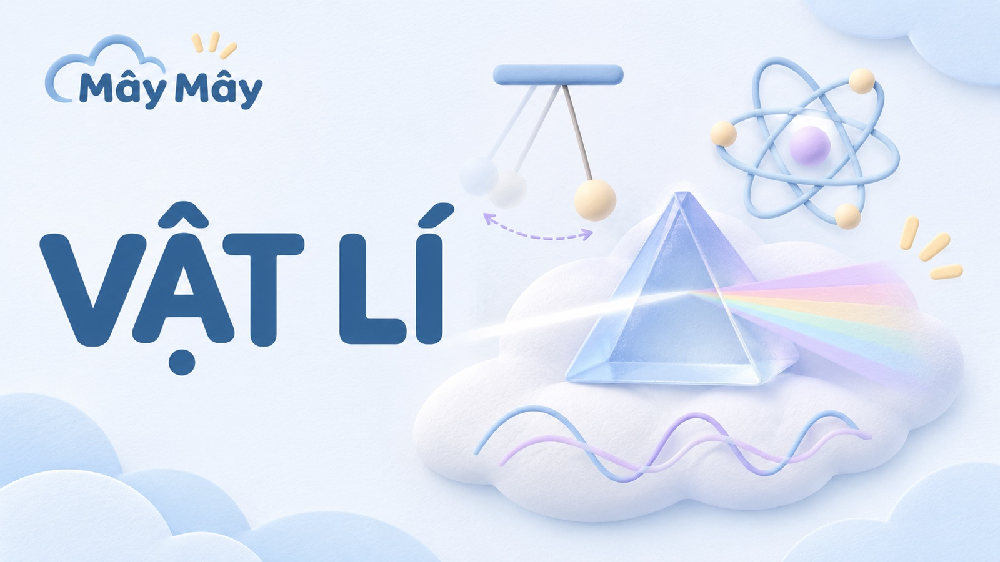
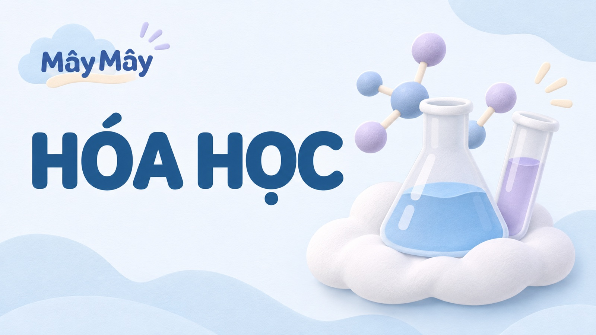
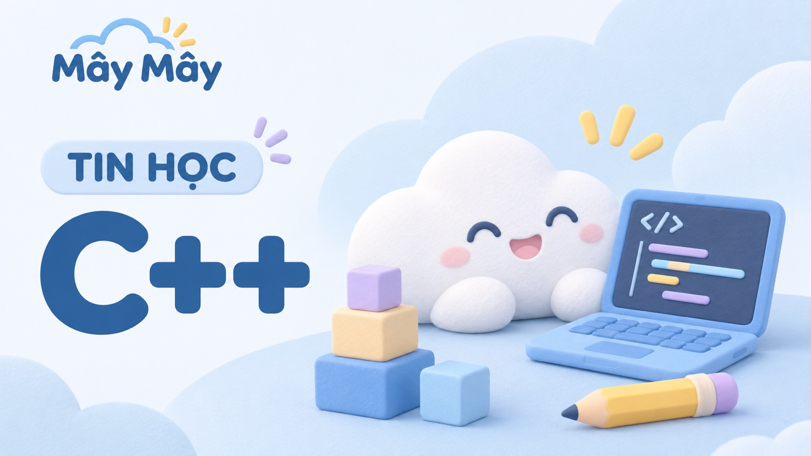
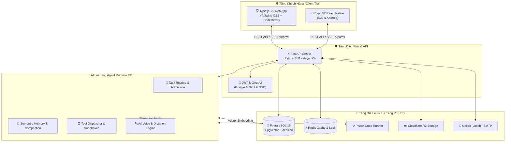

<div align="center">

  

  # ☁️ MÂY MÂY ECOSYSTEM
  ### **Nền Tảng Học Tập Thông Minh & Trợ Giảng AI Đa Nền Tảng**
  *Thiết kế theo triết lý **Cloudy Blue** — Korean Pastel Minimalism: Êm dịu, Tinh tế, Thoáng đãng & Hiện đại*

  <br />

  

  <br />

  [](https://fastapi.tiangolo.com)
  [](https://nextjs.org)
  [](https://react.dev)
  [](https://expo.dev)
  [](https://www.postgresql.org)
  [](https://github.com/pgvector/pgvector)
  [](https://www.cloudflare.com/products/r2/)

  <p align="center">
    <a href="#-tổng-quan-dự-án">Tổng Quan</a> •
    <a href="#-bộ-sưu-tập-giao-diện--trải-nghiệm">Giao Diện</a> •
    <a href="#-tính-năng-đột-phá">Tính Năng</a> •
    <a href="#-kiến-trúc-hệ-thống">Kiến Trúc</a> •
    <a href="#-khởi-chạy-nhanh-quickstart">Khởi Chạy</a> •
    <a href="#-cấu-hình-biến-môi-trường">Cấu Hình</a>
  </p>

</div>

---

<div align="center">
  
</div>

---

## 🌟 Tổng Quan Dự Án

**Mây Mây** là hệ sinh thái giáo dục trực tuyến toàn diện được thiết kế chuyên biệt cho học sinh THPT (lớp 10–12) và sinh viên. Dự án tích hợp sâu trí tuệ nhân tạo (AI Learning Agent V2) với khả năng ghi nhớ ngữ cảnh lâu dài, đàm thoại giọng nói thời gian thực và môi trường thực hành lập trình trực tuyến an toàn.

Toàn bộ trải nghiệm người dùng tuân thủ nghiêm ngặt ngôn ngữ thiết kế **Cloudy Blue (Korean Pastel Minimalism)**:
- 🎨 **Tỉ lệ vàng 70 / 20 / 10**: 70% không gian sáng & thoáng (`#F6FAFF`), 20% xanh mây pastel chủ đạo (`#356FA7`, `#E8F2FA`), 10% điểm nhấn dịu mắt (Pastel Pink, Lavender, Vanilla).
- ✍️ **Typography biên tập**: Sự kết hợp hoàn mỹ giữa font sans-serif hiện đại `"Be Vietnam Pro"` và font có chân tao nhã `"Lora"`.
- ☁️ **Linh vật Mây Mây**: Bạn đồng hành thông minh, thân thiện, hướng dẫn học tập theo lộ trình cá nhân hóa.

---

## 📸 Bộ Sưu Tập Giao Diện & Trải Nghiệm

<table align="center" width="100%">
  <tr>
    <td width="50%" align="center">
      
      <br />
      <b>🏛️ Cổng Học Viện Tri Thức Mây Mây</b>
      <p><i>Không gian học tập khoáng đạt, đón chào học viên với tinh thần tích cực</i></p>
    </td>
    <td width="50%" align="center">
      
      <br />
      <b>🤖 Trợ Giảng AI Đồng Hành Từng Phút Giây</b>
      <p><i>Giải đáp thắc mắc, phân tích tài liệu và theo sát tiến độ cá nhân</i></p>
    </td>
  </tr>
  <tr>
    <td width="50%" align="center">
      
      <br />
      <b>📚 Kho Khóa Học & Lộ Trình Phân Tầng</b>
      <p><i>Phân loại khoa học theo chuẩn GDPT mới (Toán, Lý, Hóa, Văn, Ngoại ngữ, Tin học)</i></p>
    </td>
    <td width="50%" align="center">
      
      <br />
      <b>📱 Ứng Dụng Di Động Mượt Mà (iOS & Android)</b>
      <p><i>Học tập mọi lúc mọi nơi với tính năng đồng bộ tiến độ thời gian thực</i></p>
    </td>
  </tr>
</table>

### 🎨 Bộ Nhận Diện Khóa Học Chuẩn Phong Cách Mây Mây

<table align="center" width="100%">
  <tr>
    <td align="center" width="25%">
      
      <br /><b>Toán Học THPT</b>
    </td>
    <td align="center" width="25%">
      
      <br /><b>Vật Lý Hiện Đại</b>
    </td>
    <td align="center" width="25%">
      
      <br /><b>Hóa Học Cân Bằng</b>
    </td>
    <td align="center" width="25%">
      
      <br /><b>Lập Trình C++ / Web</b>
    </td>
  </tr>
</table>

---

## ⚡ Tính Năng Đột Phá

### 1. 🤖 AI Learning Agent Runtime V2
- **Cơ chế Bounded Planner & Tool Execution**: Kiểm soát số vòng lặp và token tối đa, ngăn ngừa vòng lặp vô hạn và bảo vệ ngân sách suy luận.
- **Semantic Long-Term Memory**: Tự động lưu trữ và truy xuất sở thích học tập, phong cách tiếp thu bền vững theo tài khoản người dùng, được bảo vệ bởi sự đồng thuận (consent).
- **Automatic Context Window Compaction**: Tự động nén ngữ cảnh thông minh khi lịch sử hội thoại vượt quá 80% cửa sổ ngữ cảnh của mô hình.
- **Đa Thể Thức Bản Địa (Multimodal Vision & Audio)**: Phân tích ảnh bài tập trực quan và phụ đề bài giảng chính xác.

### 2. 🎙️ Live Voice Tutoring & Realtime Dictation
- **Đàm thoại trực tiếp độ trễ thấp**: Trợ giảng giọng nói hai chiều hỗ trợ bởi mô hình âm thanh xAI Voice STT/TTS.
- **Audio Recorder tối ưu**: Thu âm PCM16 trực tiếp trên trình duyệt, không lưu trữ audio dư thừa, tự động phiên âm văn bản vào ô nhập liệu.

### 3. 💻 Môi Trường Lập Trình Trực Tuyến An Toàn
- **Code Editor CodeMirror hiện đại**: Hỗ trợ đầy đủ C++, Python, JavaScript, TypeScript với syntax highlighting và phím tắt thông minh.
- **Chấm bài tự động qua Piston Engine**: Môi trường sandbox biệt lập, kiểm thử sample tests và hidden test cases tức thì.

### 4. 🗺️ Lộ Trình Học & Gói Khóa Học (Combos)
- **Bản đồ lộ trình học tập**: Học viên dễ dàng theo dõi từng chặng từ cơ bản đến nâng cao.
- **Gói Combo tiết kiệm**: Giảng viên có thể gom nhóm các khóa học liên quan với chính sách giá ưu đãi và hệ thống coupon linh hoạt.
- **Hệ thống Đối tác & Tổ chức Đào tạo (Providers)**: Quản lý danh mục khóa học, giảng viên và báo cáo doanh thu trực quan.

### 5. 🎮 Gamification & Tương Tác Cộng Đồng
- **Điểm danh hàng ngày & Streak Counter**: Giữ lửa học tập đều đặn với phần thưởng điểm kinh nghiệm và huy hiệu.
- **Q&A Thảo Luận Bài Học**: Quy chuẩn kiểm duyệt nội dung an toàn, hỗ trợ Markdown bảo mật (Safe HTML rendering).
- **Chuyển tặng quyền học (Gift Claims)**: Tính năng tặng khóa học hoặc combo bài học cho bạn bè qua email bảo mật.

---

## 🏗️ Kiến Trúc Hệ Thống



---

## 📂 Cấu Trúc Monorepo

```
hoctap/
├── studynest_be/              # 🐍 FastAPI Python REST API & Micro-services
│   ├── app/
│   │   ├── agent/             # 🧠 AI Agent Runtime, Routing, Memory & MCP
│   │   ├── api/v1/            # 🌐 REST Endpoints (Catalog, Bundles, Learning...)
│   │   ├── core/              # ⚙️ Cấu hình, bảo mật, LLM & Event Bus
│   │   ├── db/models/         # 🏛️ SQLAlchemy ORM Models
│   │   └── services/          # 💼 Nghiệp vụ hệ thống (Auth, Payment, Code...)
│   ├── alembic/               # 🔄 Database Migration Scripts
│   └── tests/                 # 🧪 Bộ kiểm thử tự động (Unit, Integration, Browser)
│
├── studynest_fe/              # ⚡ Next.js 15 Web Client
│   ├── src/
│   │   ├── app/               # 🧭 App Router (Admin, Lecturer, User routes)
│   │   ├── components/        # 🎨 Cloudy Blue Design System & UI Shared
│   │   │   ├── ui/            # 🧩 Primitives (Button, Card, Badge, Modal...)
│   │   │   └── user/          # 🎓 Giao diện học tập, trợ giảng AI, phòng thi
│   │   └── lib/               # 🛠️ Client utilities & API clients
│   └── public/                # 🖼️ Assets, Audio, Mascot & Video Cinematic
│
├── mobile/                    # 📱 React Native & Expo 52 Mobile App
│   ├── app/                   # 📱 Expo Router Screens
│   ├── components/            # 🧩 Native UI Components
│   └── src/                   # 📦 Services & State Management
│
├── data/lessons/              # 📚 Dữ liệu bài giảng mẫu & Tài nguyên Covers
├── docs/                      # 📖 Tài liệu kiến trúc, hướng dẫn & kiểm thử
└── db.sql                     # 🗄️ Database snapshot đầy đủ với pgvector
```

---

## 🚀 Khởi Chạy Nhanh (Quickstart)

### Chạy toàn bộ web local bằng Docker

Mở Docker Desktop hoặc OrbStack có Docker Compose v2.24 trở lên, rồi chạy tại thư mục gốc của repo:

```bash
docker compose up -d
```

Compose tự build web và API, bật PostgreSQL, Redis, Mailpit và Piston, rồi chạy migration, nạp danh mục mẫu và cài runtime chấm code. Lần đầu cần tải image, build ứng dụng và tải runtime. Xem tiến độ bằng `docker compose ps -a` và `docker compose logs -f backend frontend piston-runtimes`.

| Dịch vụ | Địa chỉ local |
| :--- | :--- |
| Web Mây Mây | [http://localhost:3000](http://localhost:3000) |
| FastAPI / Swagger | [http://localhost:8000/docs](http://localhost:8000/docs) |
| Mailpit (email và OTP) | [http://localhost:18025](http://localhost:18025) |
| Piston | http://localhost:14000 |
| PostgreSQL + pgvector | `127.0.0.1:15433` |
| Redis | `127.0.0.1:16379` |

Dừng stack bằng `docker compose down`. Dữ liệu trong volume vẫn được giữ. Sau khi sửa code, dùng `docker compose up -d --build` để build lại image.

Nếu cổng mặc định đang được dùng, xem [cách đổi cổng web và API dev](docs/infra/local-docker.md#đổi-cổng-khi-chạy-song-song).

Xem [hướng dẫn xuất và nạp database trên máy khác](docs/infra/local-docker.md).

Các tích hợp AI, R2, Google OAuth và PayPal cần credential dev hoặc sandbox. Có thể đặt các biến backend theo mẫu `studynest_be/.env.development.example` trong `studynest_be/.env.docker.local`. Với Google OAuth và PayPal, đặt thêm các biến công khai `NEXT_PUBLIC_URL_GOOGLE_LOGIN` và `NEXT_PUBLIC_PAYPAL_CLIENT_ID` trong `.env` ở thư mục gốc, sau đó build lại.

### Hot reload và ứng dụng mobile

Để chạy backend và web trực tiếp trên máy với hot reload, dùng `make dev-up` để bật riêng hạ tầng rồi xem [hướng dẫn cấu hình môi trường](docs/infra/environments.md).

Expo chạy riêng trên máy. Sao chép `mobile/.env.example` thành `mobile/.env` và trỏ `EXPO_PUBLIC_API_URL` đến `http://127.0.0.1:8000/api/v1`, `EXPO_PUBLIC_WS_URL` đến `ws://127.0.0.1:8000` khi dùng iOS Simulator. Sau đó chạy:

```bash
cd mobile
pnpm install --frozen-lockfile
pnpm dev
```

Với Android Emulator, dùng `10.0.2.2` thay cho `127.0.0.1`. Xem [hướng dẫn mobile](mobile/README.md) để chọn môi trường chạy Expo.

---

## 🔑 Cấu Hình Biến Môi Trường (Third-Party Services)

Các dịch vụ nâng cao có thể được kích hoạt trong file `studynest_be/.env.docker.local` khi dùng Compose, hoặc `studynest_be/.env.development` khi chạy backend trực tiếp:

- **AI Model Router (9Router)**:
  ```env
  LLM_PROVIDER=9router
  NINEROUTER_BASE_URL=https://9router.itup.io.vn/v1
  NINEROUTER_API_KEY=your_key_here
  NINEROUTER_MODEL=gemini
  NINEROUTER_STREAM=True
  ```
- **Gemini Embeddings Trực Tiếp**:
  ```env
  EMBEDDING_PROVIDER=gemini
  EMBEDDING_MODEL=gemini-embedding-001
  EMBEDDING_DIMENSIONS=1536
  GOOGLE_API_KEY=your_google_ai_key
  ```
- **xAI Live Voice & Realtime Dictation**:
  ```env
  XAI_API_KEY=your_xai_api_key
  TUTOR_VOICE_ENABLED=True
  TUTOR_VOICE_MODEL=grok-voice-latest
  TUTOR_DICTATION_ENABLED=True
  TUTOR_DICTATION_MODEL=grok-voice-transcribe-2.0
  ```
- **Lưu Trữ File Đám Mây (Cloudflare R2)**:
  ```env
  STORAGE_PROVIDER=r2
  R2_ACCOUNT_ID=your_account_id
  R2_ACCESS_KEY_ID=your_access_key
  R2_SECRET_ACCESS_KEY=your_secret_key
  R2_BUCKET_NAME=maymay-storage
  R2_PUBLIC_DOMAIN=https://static.maymay.edu.vn
  ```
- **Xác Thực Google & GitHub OAuth**:
  ```env
  GITHUB_OAUTH_CLIENT_ID=your_github_client_id
  GITHUB_OAUTH_CLIENT_SECRET=your_github_client_secret
  ```

---

## 🧪 Kiểm Thử Hệ Thống (Quality Assurance)

```bash
# Kiểm tra toàn bộ Unit Test Backend (603/603 tests)
cd studynest_be && source .venv/bin/activate && pytest tests/unit -q

# Kiểm tra TypeCheck Frontend Web
cd studynest_fe && pnpm exec tsc --noEmit

# Kiểm tra TypeCheck Mobile App
cd mobile && npx tsc --noEmit
```

---

## 👨‍💻 Tác Giả & Bản Quyền

- **Tác giả chính**: **Nguyễn Ngọc Ánh** — [@nguyenhuynhdt37](https://github.com/nguyenhuynhdt37)
- **Thiết kế & Kiến trúc**: Hệ thống thiết kế **Cloudy Blue** & Kiến trúc Mây Mây Monorepo.
- **Giấy phép**: Phát hành theo chuẩn mã nguồn mở học thuật. Vui lòng ghi rõ nguồn khi tham khảo hoặc tái sử dụng.

<div align="center">
  <br />
  <p><i>Được xây dựng với tình yêu thương dành cho giáo dục và trải nghiệm học tập Việt Nam 🇻🇳</i></p>
  <p><b>Mây Mây — Học Nhẹ Nhàng Như Mây Trôi ☁️✨</b></p>
</div>
