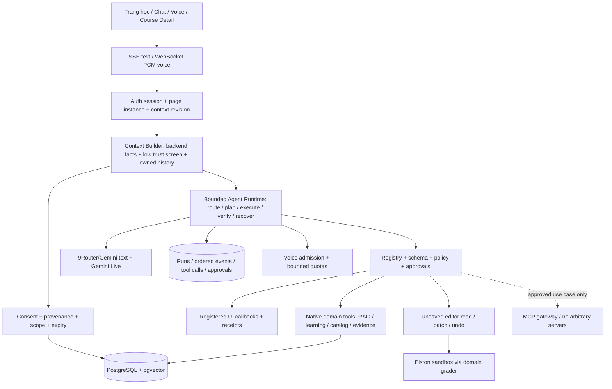
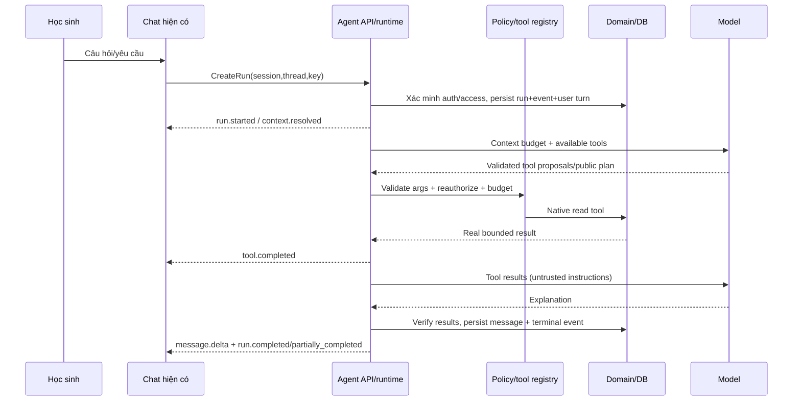
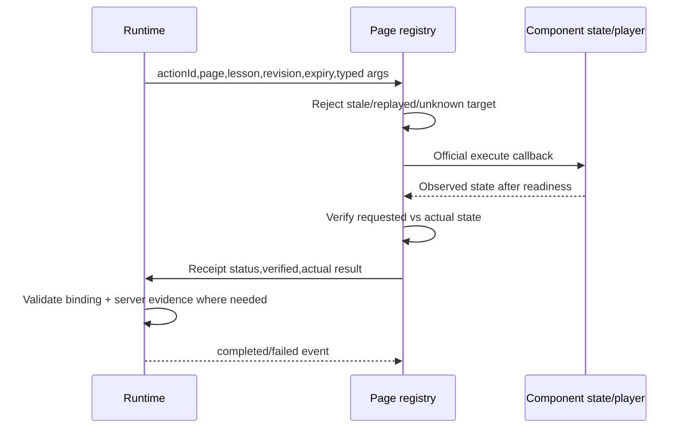
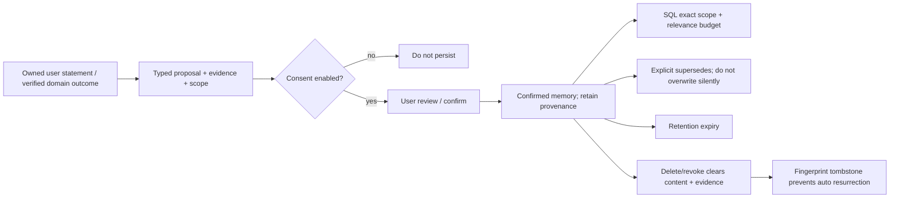
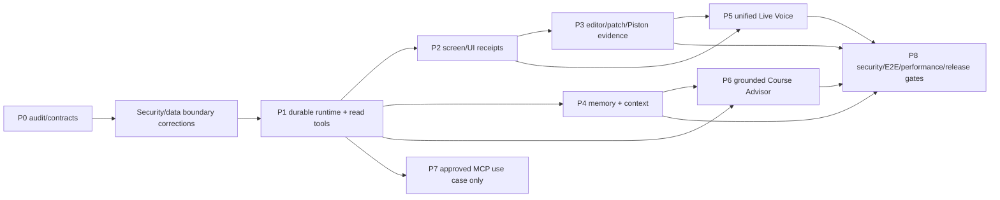

# Mây Mây AI Learning Agent Harness V2

Ngày khảo sát: 13/11/2026. Baseline Git: `6c92ece9adaef2a394c7909c7d1fd5c6ff43b20e`. Git ban đầu sạch. Người dùng sau đó mở rộng quyền: quản lý đội subagent, triển khai và tích hợp toàn bộ theo roadmap; không tự deploy production.

## A. Mục tiêu và giới hạn bằng chứng

Nâng trợ giảng RAG hiện có thành runtime có trạng thái, context đúng phiên, tools có quyền, verification, memory có consent và dùng chung text/voice. Giữ FastAPI, Next.js, PostgreSQL/pgvector, Redis, 9Router/Gemini, Piston, thread IDs, enrollment và tài chính. Tài liệu này ghi kiến trúc và kế hoạch; trạng thái kiểm thử thực tế được ghi riêng trong `docs/verification/ai-learning-agent-v2.md`. Không suy diễn production-ready từ unit tests.

## B. Kiến trúc và khảo sát hiện trạng

| Phần | Đã có ở baseline | Khoảng trống phải xây |
|---|---|---|
| Text Tutor | CRUD thread theo user/lesson, soft delete, 12 messages gần nhất, rule classifier, RAG lesson/section/course, citations server-grounded, SSE delta/done/error, ảnh OCR/R2 | Run state, plan/tool loop, budget tổng, cancellation bền vững, event replay, rolling context, action approvals |
| Voice | Gemini Live, PCM16 mono input16kHz100ms; output24kHz; AudioWorklet, native VAD/interruption, transcripts/citations vào thread cũ, Redis NX lease1/user TTL max+30s, max600s,4 searches/turn | Dùng chung registry/policy, verified UI tools, phối hợp text/voice và cancellation |
| Learning | SWR curriculum/active lesson/navigation, lesson renderer video/article/quiz/code, sidebar/chat/tab local states, notes API | Snapshot structured page/revision, registered callbacks và receipts; không dựa DOM selectors |
| Video | Luồng thực dùng YouTube iframe/player ref; globals seekVideo/getCurrentTime/pauseVideo theo lessonId | Adapter chính thức play/pause/seek/rate/get_state, readiness/error và xác minh sau action |
| Editor | CodeMirror6 (tên helper cũ nhắc Monaco), nhiều exercise/files, local buffers và savedFileContents; save blur/đổi file; test gửi buffer hiện tại | Selection, revision, atomic patch/diff/approval/undo, CAS save, test evidence gắn đúng buffer |
| Piston | Multi-file, main first, stdin, private runner bearer; hosted compose isolation/network off/output/time/memory caps | Domain authorization trước save/test, execution admission/budgets, sample semantics, compile verdict, version-bound attempt |
| Memory | Bảng lesson_tutor_memory(user,lesson) có summary/topics/confusions nhưng không thấy runtime đọc/ghi; local0rows | Consent/evidence/conflict/expiry/delete; không coi schema tồn tại là tính năng đã hoạt động |
| Catalog | Catalog V2 taxonomy/grade/subject/goal/exam/provider; public_course policy; versioned learning paths; recommendation embedding | Grounded advisor/compare theo tiêu chí, không dùng similarity như phần trăm phù hợp |

### Luồng hiện tại

Text: `message-input -> POST tutor-chat/lessons/{id}/chat -> ownership + lesson access -> 12 history messages + OCR -> local greeting/follow-up rule -> _rag_search -> prompt -> LLMService -> grounded citation -> DB commit -> SSE done`. User message được flush trước model nhưng commit cuối transaction, không phải bền vững ngay như comment trong source. Greeting không embed. Quiz/code retrieval đọc trực tiếp; video/resource dùng vector SQL function threshold0.7 top3, query embed timeout8s; quiz/code resources thêm top2. Section/course retrieval yêu cầu enrollment khi mở rộng từ preview. Selector scope đang ẩn ở web nhưng backend vẫn hỗ trợ.

Voice: `explicit Start -> AudioContext+getUserMedia -> AudioWorklet -> WS authenticated subprotocol -> account+lesson access -> Redis lease -> Gemini Live -> search_lesson -> same RAG -> transcript/source persistence`. Frontend không tự reconnect vô hạn, Stop/close/unmount dọn tracks/context/socket/playback. Provider interruption dừng audio queue. Browser hỗ trợ vật lý Safari/iOS chưa suy ra từ code. Native SDK VAD dùng default, không có browser VAD tự viết.

Code: `buffer local -> test payload files -> per-test Piston -> verdict -> pass flags saved files`. Baseline test không tự lưu submitted buffer; do đó báo `saved=true` và set DB file is_pass có thể không tương ứng code vừa chạy. FE dùng85% còn server100%. Save API chưa CAS; saveFile catch nuốt lỗi khiến savedFileContents có thể ghi nhận sai; effect activeFile về main mỗi thay đổi nội dung.

### Phát hiện rủi ro theo source

1. **Ưu tiên cao — rò lời giải**: `_rag_search` ở tutor_chat_message.py baseline đưa teacher solution vào prompt; quiz đưa đáp án đúng/explanation trước attempt. Cả voice tái sử dụng đường này. Phải lọc tại DTO/domain boundary, không chỉ prompt.
2. **Ưu tiên cao — hidden test**: lecturer UI gọi is_sample là Sample; Tutor lấy True làm sample; Learning/get/test lại coi True là hidden. Local77 tests gồm26True/51False. Không đảo dữ liệu mù; chuẩn hóa semantics cùng regression fixture và bảo toàn rows.
3. **Ưu tiên cao — domain auth**: save/test route chỉ authenticate, service chưa xác minh enrollment/exercise-course; set_active_lesson chưa kiểm lesson thuộc course. Tool không được bọc trực tiếp service thiếu authorization.
4. **Ưu tiên cao — bằng chứng code**: chạy code bufferB rồi đánh dấu savedA PASS; không có durable attempt/suite hash/revision.
5. **Context stale**: local activeLesson khác initialActiveLesson SWR; navigation catch set UI ngay cả API fail. Không thể coi callback return void là success.
6. **Thread race**: index active thread baseline không unique; get-or-create/create/choose thiếu serialize đồng thời. Cursor updated_at không tie-breakID.
7. **Grounding có giới hạn**: citation ID xác minh nguồn có thật, chưa chứng minh mọi câu trong answer được nguồn entail. Regex timestamp trong generated text không đủ chứng minh đã align video. Video extraction baseline còn cho phép suy luận metadata khi không truy cập video.
8. **Security vận hành**: main.py vô hiệu hóa SSL verification toàn cục; Gemini direct có raw error text; WS auth chung vẫn nhận query tokens dù web voice dùng subprotocol; CORS wildcard hiện tại cần production origins rõ.
9. **Mastery thiếu bằng chứng**: quiz practice chấm client và lesson completion không tương đương mastery. Không dùng progress boolean làm trình độ đã chứng nhận.
10. **Test isolation**: conftest fallback tới DB local nếu thiếu TEST_DATABASE_ASYNC_URL; integration phải fail closed/skip khi chưa chọn DB thử.

### Phân biệt section Course Advisor

Không thấy literal tiêu đề “Tại Sao Bạn Nên Chọn Khóa Học Này” trong source hiện tại. Truy vấn READ ONLY database local xác nhận đây là **tên một bài video** thuộc khóa **Tin học THPT · JavaScript và lập trình web** (published), không phải section Course Detail. Course Detail render Outcomes/Curriculum/Description/Requirements/TargetAudience/Instructor/Reviews từ DB. `home/benefits-section.tsx` là lợi ích nền tảng “Vì sao chọn Mây Mây?”, hoàn toàn khác bài video này. Chỉ có main local; remote refs an-dev/huynh/huynh2 được nhìn thấy, chưa checkout hoặc thay đổi nhánh. Không khẳng định đã rà mọi dữ liệu trên remote branches/CMS ngoài local DB.

### Architecture diagram mục tiêu



Tách module khi có quyền/lifecycle khác nhau; không tạo service/file rỗng cho mỗi khối. Native tools gọi domain service trong FastAPI. SQL authoritative state, Redis admission, in-process tasks có deadline và không replay mutation sau worker chết.

### Sequence text agent



### Sequence voice agent

```mermaid
sequenceDiagram
    participant F as Explicit mic UI
    participant V as Existing voice relay
    participant G as Gemini Live
    participant A as Same agent runtime
    participant T as Native tool/UI bridge
    F->>V: WS subprotocol auth + agent_session_id
    V->>A: Bind same user/auth session/page/lesson
    V->>G: PCM16k + filtered function declarations
    G-->>V: Native tool call ID
    V->>A: Stable idempotency key + actual user transcript
    A->>T: Shared schema/policy/approval/execute
    A-->>F: Same agent_event semantics
    T-->>A: Authoritative result / verified UI receipt
    A-->>V: Result with evidence kind
    V->>G: Tool response
    G-->>F: PCM24k + captions
    F->>V: Interruption/Stop
    V->>A: Cancel pending tool; do not rollback committed effects
    V->>V: Save actual transcript into original tutor thread
```

### Sequence UI action



Navigation is an expected lesson transition: bind source lesson/page/revision AND server-resolved target, wait new state, acknowledge target; unrelated lesson change cancels. Client receipt can verify player/UI, never finances or server persistence.

### Sequence coding agent

```mermaid
sequenceDiagram
    participant U as Học sinh
    participant A as Agent runtime
    participant E as Editor registry
    participant D as Domain grader
    participant P as Piston
    A->>E: Read selected/active multi-file buffer + revision
    E-->>A: Unsaved content + file identities + revision
    A->>E: Propose bounded hunks expected text
    E-->>U: Diff preview
    U->>A: Approval bound exact args hash + revision
    A->>E: Apply exact approved patch
    E->>E: Atomic compare revision/text, apply, preserve undo
    E-->>A: Verified post-state/revision
    A->>E: Run sample tests on current buffer
    E->>D: Files+exercise+revision+mode
    D->>D: Auth, language, size, filename, budgets
    D->>P: Sandbox execute per permitted test
    P-->>D: Exit/compile/stdout/stderr/limits
    D->>D: Persist owned version-bound attempt, redact hidden
    D-->>A: Verified result ID/hash; no stale saved PASS
    A-->>U: Actual outcome + explanation + remaining failures
```

## Context flow và freshness

`auth principal -> resolve course/lesson/exercise -> snapshot validation -> intent relevance -> demand tools -> source dedup -> token budget -> prompt`. Client snapshot không chứa code mặc định, chỉ editor active_file_id/revision/is_dirty/selection. Code đọc qua client tool khi cần. snapshot có schema_version,page_instance_id,revision,captured_at,route,course_id,lesson_id,exercise_id,active_tab/panel,video/current_time,is_playing/rate,editor,quiz. Timestamp phải timezone, age bounded; same revision khác dữ liệu bị từ chối. Backend facts luôn có priority quyền; screen là low-trust hint.

Budget cấu hình: max duration240s, tools12, planning iterations6, input estimated40k; tool timeout20s mặc định, sample test90s, approval120s; no parallel mutations. Các giá trị là mặc định triển khai cần tuning bằng benchmark, không phải kết quả đo. Khi lỗi hoặc hết budget trả partial và chỉ rõ việc chưa xong. Không tải mọi transcript/history vào prompt. Đọc selected code trước active file, requirements rồi recent sample evidence.

## Memory lifecycle

L0 runs/tool/approval/cancel = SQL runtime, không vector. L1 reuse tutor threads + extractive rolling summary có message provenance, giữ mục tiêu đầu và các user requests ngoài cửa sổ12messages. L2 lesson scoped items và unresolved task/hints. L3 course/profile chỉ explicit opted-in learning goals/preferences. L4 lấy server quiz/code attempts, progress ghi rõ không phải mastery.



No psychological/ability diagnosis kinds, no audio persistence. Agent-created memory confidence0 proposal; confirmation reflects learner consent, not proof of mastery. Mastery must cite exercise/quiz attempt. Default consent off; retention1..365days(default90), review/edit by superseding/delete self-only. Teacher/provider/admin tools do not expose private learner memory. User-specific memories never share caches across users.

## Tool permission matrix

| Tools | Risk | Boundary checks | Approval / verification |
|---|---|---|---|
| knowledge search/source | READ | Auth, lesson/enrollment, scope, source visibility | Retrieved IDs and source provenance |
| lesson/curriculum/progress | READ | Same user/current course; progress!=mastery | Domain data |
| catalog get/search/compare/path | READ | public_course/published path only; no draft leak | Metadata evidence; no fabricated fit% |
| ui/video/navigation | NAVIGATION | Registered capability,user/session/page/revision/expiry,current+target lesson | Explicit user intent; observe actual UI/player state |
| editor state/read/selection | READ | Active exercise,file role=user/starter,content size,revision | Current unsaved buffer receipt |
| editor propose patch | READ/proposal | Hunks validate bounds/text/revision | Diff shown, no mutation |
| editor apply/undo | WRITE | Exact approved args hash,page,revision,one-time action | User approval + atomic compare + undo + receipt |
| code sample tests | bounded execution | Auth, exercise language/files,run rate/size,scope | Durable attempt verified server-side; no save implied |
| code allowed hidden tests | domain-only grading | Hidden inputs/expected never model/client | Aggregated sanitized result; no raw hidden stdout |
| memory read/propose | READ/proposal | Owner+scope+consent+owned evidence | Proposal never auto-fact |
| memory confirm/delete | WRITE | Self API,explicit user controls | Confirmation/deletion lifecycle, no provider access |
| financial/admin/system/browser external | HIGH RISK | Not in registry | Not exposed in release |

## API contracts và transport

Wire dùng snake_case, Pydantic extra=forbid, bounded strings/arrays. Prefix `/api/v1/agent`. Legacy `/tutor-chat` JSON/SSE và voice vẫn giữ; khi harness disabled web fallback Tutor.

| Endpoint | Contract |
|---|---|
| POST /sessions | page_instance_id,route,course_id?,lesson_id?,capabilities[] -> id/context_revision/expiry |
| PUT /sessions/{id}/context | ScreenSnapshot v1 -> validated session |
| POST /runs | session_id,thread_id?,message,idempotency_key,channel -> persisted run_id/state |
| GET /runs/{id} | Owner/auth-session read authoritative state |
| GET /runs/{id}/events?after=N | SSE ordered replay, Last-Event-ID sequence, never re-executes mutation |
| POST /runs/{id}/cancel | Terminal cancellation; effects not implicitly rolled back |
| POST /runs/{id}/approvals/{id} | decision approved/rejected,page_instance_id,context_revision |
| POST /runs/{id}/actions/{id}/receipt | status,verified,page,context_revision,lesson_id,result?,error?; duplicate exact accepted, conflict409 |
| /memory/consent GET/PUT | enabled,retention_days; off erases memory content |
| /memory GET/POST/DELETE | self-only list/propose/delete all |
| /memory/{id}/confirm POST; DELETE | explicit review/confirm/delete |
| POST /advisor | course_id,question,goals?,grade?,budget?,currency,compare_course_ids[] -> criterion claims/evidence/limits/followups |
| GET /advisor/{id}/context | Public sanitized course metadata only |

Event envelope `{schema_version:1,id,run_id,sequence,type,timestamp,payload}`. Types run.started,context.resolved,plan.created/updated,tool.proposed/awaiting_approval/started/completed/failed,ui.action_requested/ui.action_receipt,message.delta,memory.proposed,run.completed/partially_completed/cancelled/failed. Payload validates per operation; model cannot set terminal success. Voice wraps same envelope as `{type:agent_event,event:...}` alongside existing audio/transcript events.

ToolDefinition names stable with typed input schema/risk/timeout/idempotence/approval/client callback/handler. Tools availability intersects backend registry, authenticated permission,current route/current lesson and client registered capabilities. Unavailable tool never advertised. Gemini aliases dots to `__`, maps validated schemas, returns to same native registry. Text uses validated structured JSON adapter; native tool calling support of arbitrary9Router models is **not assumed**.

## Proposed persistence / indexes

Existing IDs and schemas retained. Additive entities: agent_sessions(owner/auth_sid/page/route/snapshot/revision/expiry),agent_runs(owner/session/thread,state,channel,plan/version/step,budgets,deadline,cancel/error,idempotency_key+request_hash),agent_events(run,sequence,type,validated payload),agent_tool_calls(args hash,risk,status,action binding,receipt,result),agent_approvals(exact args/page/revision/expiry/status). Unique(owner,idempotency_key), unique(run,sequence), partial unique active owner serialize cross-tab text/voice; indexes session/time,tool/run and expiration.

MemoryConsent(userPK,enabled,retention,policyVersion),LearningMemoryItem(owner,scope,course/lesson,kind,content,status,confidence,evidence,source,supersedes,fingerprint,expiry),AgentThreadSummary(threadPK,owner,summary,evidence IDs,watermark). Existing LessonTutorMemory is legacy projection; not inferred authority. Unique(owner,fingerprint),scope lookup index,expiry index. code_test_attempts bind buffer hash/revision/language/suite hash/mode/result; quiz_attempts bind submitted options and immutable question snapshot/hash. No finance/enrollment rewrite.

Retention proposal: transient audio never stored; runtime detailed events/tool payload30days configurable, remove raw code content from audit before persistence where possible; memories explicit1..365days; summaries follow owned thread lifecycle. Purge must physically clear expired contents, not merely hide queries. Legal/parental policy and deletion of historical backups require product/legal operational ownership before child-wide production rollout.

## Concurrency, cancellation và recovery

One active run/user is an intentionally conservative initial policy enforced in SQL across workers and channels. Redis voice lease remains one connection/user; run gate protects actions even when voice connection stays open. Idempotency stored server with request hash; event replay only observes. Context update, receipts and approvals use row locks; compare-and-set editor hunks and saved content hashes prevent stale overwrites.

Stop sets terminal state and cancels local task; other workers poll committed state. Lesson switch cancels unless it is the authorized pending navigation target. Page unload cleanup is best effort; backend expiry is authoritative. Auth/access rechecked at each tool and periodically for voice audio. Worker loss expires abandoned run; mutations never blindly replay. Actions have proposed/started/committed(receipt)/cancelled distinction. Already committed patch/note/test evidence remains, undo separate explicit action. Interruption drops audio and cancels pending tool responses; no old response may silently overwrite new revision.

## MCP strategy

The user subsequently authorized bundled web search and public GitHub tools. These now use a local MCP stdio server with a fixed allowlist, fixed GitHub API host, timeout/output limits and credential isolation. No arbitrary server URL, shell or private GitHub account access is exposed. See [current implementation and verification](agent-lesson-context-mcp.md). Native application permissions and verified completion remain authoritative; reading a repository is not official grading.

## Threat model

Boundaries: browser screen and receipts; model output; learner code; retrieved PDF/transcript/comments; provider APIs; DB authorized services. Attacks include instruction override in code/PDF, forged IDs/args, cross-user memory/source, old page action replay, duplicate patch, approval hash swap, hidden expected outputs in stderr/stdout, Piston network escape, quota exhaustion, voice token in URL/log, simultaneous textvoice action. Defenses: schema validation, capability allowlist, server reauthorization, source DTO exclusion, original buffer hashes, immutable attempts, exact approval/action binding, bounded retries/time/output, no financial tools, sanitized errors, mic cleanup. Denials and failures need reason categories/IDs without raw secrets/PII.

## Observability / eval / rollout gates

Log request/run/tool correlation, provider route, retrieval/tool/verification latency, denial/stale/retry/cancel counts and token estimates. Token estimates are not provider billing; actual provider usage/cost must be recorded when upstream returns it, never label guesses as measured costs. Metrics success/tool failure/invalid args/denials/citation checks/session duration/Piston failure/context size derive deterministic events. No raw code/audio/access token logs.

Test matrix: greetings avoid retrieval; substantive Q retrieves original; thread/user/course isolation; preview cannot broaden; forged citations/timestamps dropped; lesson change; unsaved multi-file selection; wrong revision/approval replay; fake UI success; run budget/cancel/reconnect; code compiler/runtime/wrong answer/output/network/time limits; sample/hidden/solution redaction; code saved-buffer conflict; server quiz evidence; memory consent/conflict/expiry/deletion/isolation; provider failures; prompt injection in every untrusted source. LLM-as-judge only expression quality, never domain correctness. Real external/provider/device tests reported separately from mock tests.

## Phase dependencies và implementation plan



1. P0: code-backed architecture, risk inventory, contracts/data/permissions, preserve baseline.
2. Safety/P1: fix solution/hidden/auth boundaries, run/event/tool/approval schema additive, registry and validated model adapter, direct read tool plus errors/cancel/budget; regression legacy.
3. P2: official callback registry above keyed lesson/chat, snapshot/expiry/revisions, navigation/video/panels/tabs with verified receipts and replay guards.
4. P3: current buffers/selection, multi-file bounded atomic patches, diff approval/undo, CAS save, sample tests and server attempt provenance.
5. P4: default-off consent, typed proposals/evidence/confirmation/superseding/expiry/delete, rolling context, verified quiz/code evidence.
6. P5: reuse Gemini Live PCM/WS/lease; filtered tool schema/shared policy, event pump, actual transcript intent, cancellation/idempotence/cleanup.
7. P6: public course metadata/criteria/evidence/compare, explicit personal inputs, no invented reviews or fit%, explicit voice explanation.
8. P7: remain gated without approved connector; implement only when tool runtime stable AND real connector authorized.
9. P8: unit/integration/contract/TS/build/browser E2E/live providers, budgets/cost/failure tests, isolated migration upgrade/downgrade+backup, rollout docs and rollback. Never auto-deploy production.

Migration risks: source DB revision was h45c78d90e12 while source already includes later i/j migrations; always inspect full chain and test clone, do not stamp/reset. Preserve active-thread duplicates until reconciliation before unique constraint; do not rewrite is_sample flags blindly; do not claim progress==mastery or save==test. Feature flag off defaults permit rollback to legacy Tutor while retaining additive tables and historical chat. Destructive downgrade only isolated test DB or explicit backed-up approval; application rollback should keep tables/data.
