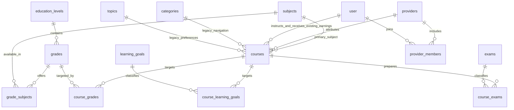

# Education Catalog V2 — triển khai, API và QA

## Kết quả và phạm vi

Catalog V2 mở rộng hệ thống cũ bằng taxonomy học thuật độc lập và provider. `category_id`, `topic_id`, course ID/slug, người giảng dạy và các bảng tài chính/học tập được giữ. Không có dữ liệu khóa học/provider giả được thêm vào database local. Tám khóa cũ vẫn unpublished trong Lưu trữ; không suy đoán lớp/môn từ tên.

Frontend: `/khoa-hoc`, `/providers/[slug]`, `/admin/catalog`, `/lecturer/providers`; form tạo/sửa khóa học và course detail được tích hợp. Expo có service/types mới và bộ lọc lớp/môn trong màn danh mục, giữ navigation và auth cũ.

## Schema và ERD

Migration: `c34d56e78f90` (sau `b23c45d67e89`). 11 bảng mới:
`education_levels`, `grades`, `subjects`, `grade_subjects`, `learning_goals`, `exams`, `providers`, `provider_members`, `course_grades`, `course_learning_goals`, `course_exams`.
Courses thêm `subject_id`, `provider_id` nullable và `delivery_type` mặc định `recorded_video`. Có FK, unique code/slug, grade_number 1–12, enum checks provider/member/delivery và index hai chiều cho mapping. Public catalog index partial `(created_at DESC,id DESC)` cho published+approved+not deleted. Không đổi ID khóa hoặc người nhận tiền.



## Seed và dữ liệu môn học

Seed idempotent `scripts/seed_catalog_v2.py`: 3 cấp, 12 lớp, 15 môn dùng chung, 76 quan hệ lớp/môn, 6 mục tiêu và 5 nhóm kỳ thi. Đây là bộ môn khởi đầu cho marketplace, không phải danh sách đầy đủ hoặc luật bắt buộc của một chương trình. Admin bổ sung môn/chương trình qua API và mapping; frontend không hardcode môn theo lớp.

Nguồn đối chiếu: [Chương trình tổng thể hợp nhất của Bộ GDĐT](https://moet.gov.vn/content/vanban/Lists/VBPQ/Attachments/1483/vbhn-chuong-trinh-tong-the.pdf), [hướng dẫn Ngoại ngữ 1 tiểu học](https://xaydungchinhsach.chinhphu.vn/huong-dan-to-chuc-day-hoc-cac-mon-ngoai-ngu-1-cap-tieu-hoc-119230810082407558.htm). Tiếng Anh lớp 1–2 là lựa chọn bổ trợ; bảng mapping thể hiện khả năng cung cấp, không khẳng định bắt buộc. Tin học và Công nghệ tiểu học tách khỏi Tin học THCS/THPT; môn tích hợp giữ tên riêng. Chưa gắn đề thi, cấu trúc đề, năm thi, tỉnh hoặc chứng nhận pháp lý vào các nhóm kỳ thi; cần module cấu hình theo phiên tuyển sinh khi triển khai nội dung đó.

Seed dùng ON CONFLICT DO NOTHING và tra lại ID theo code: không ghi đè tên/sắp xếp/active do admin chỉnh sửa. Chỉ chạy seed khi khởi tạo/nâng cấp chủ động, không chạy mỗi lần API startup. Mapping seed được thêm lại nếu chạy seed lần nữa; không dùng seed để đồng bộ xóa mapping của admin.

## Triển khai an toàn

Database mới: Docker Compose import `db.sql` hiện có → `alembic upgrade head` → `python scripts/seed_catalog_v2.py`. Không sửa dump lớn. Database hiện hữu: backup PostgreSQL trước upgrade, chạy cùng lệnh migration và seed. Chỉ thực hiện local trong phiên làm việc; không deploy hoặc migrate production.

Bản backup trước chuỗi thay đổi taxonomy nằm tại `studynest_be/backups/k12-taxonomy/before-taxonomy.dump`. Bản sau additive schema, trước seed V2: `studynest_be/backups/catalog-v2/after-additive-schema.dump`. Lệnh tạo backup V2 đầu tiên bị lỗi đọc dotenv; migration additive đã chạy trước khi tạo bản backup thứ hai. Backup trước đó vẫn có đầy đủ dữ liệu legacy. Các file này private và không vào Git.

Phân loại dữ liệu cũ bằng admin theo course ID hoặc JSON rõ ràng:

```json
[{"course_id":"<UUID khóa học>","education":{"subject_id":"<UUID môn>","grade_ids":["<UUID lớp>"],"learning_goal_ids":[],"exam_ids":[],"provider_id":null,"delivery_type":"recorded_video"}}]
```

```bash
cd studynest_be
.venv/bin/python scripts/map_course_taxonomy.py mapping.json
.venv/bin/python scripts/map_course_taxonomy.py mapping.json --apply --backup backups/<backup>.dump
```

Mặc định dry-run; validate toàn bộ trước commit, không đổi slug/ID/publication, không đoán môn/lớp. `needs_classification` trong response thể hiện thiếu lớp hoặc môn.

Rollback production nên quay code và giữ additive schema. Downgrade V2 làm mất metadata V2, chỉ chạy trên database thử hoặc sau backup và kế hoạch phục hồi; không mất courses, lessons, enrollment hoặc earning legacy. Upgrade/downgrade đã được kiểm tra trên bản sao riêng `studynest_catalog_v2_test`.

## API contract

Prefix backend `/api/v1`, web proxy `/api`.

| API | Quyền / nội dung |
| --- | --- |
| GET `/catalog/levels`, `/grades`, `/subjects`, `/learning-goals`, `/exams` | Public, active records; subjects hỗ trợ `grade=1..12` |
| GET `/catalog/filters` | Các lựa chọn và grade_subjects từ DB; chỉ recorded_video được mở |
| GET `/catalog/courses` | Public published+approved+not deleted, provider đủ điều kiện |
| GET `/catalog/courses/{id}/taxonomy` | Public course; owner/admin được đọc metadata của draft |
| GET `/providers`, `/providers/{slug}` | Thông tin công khai, không email/điện thoại học sinh |
| GET/POST `/lecturer/providers`, PUT `/lecturer/providers/{id}` | Membership/owner/manager kiểm tra phía server |
| PUT `/providers/{id}/members` | Owner hoặc admin; không thu hồi owner cuối cùng |
| GET/POST `/admin/catalog/{kind}` | Admin; kinds: levels, grades, subjects, learning-goals, exams |
| PUT/DELETE `/admin/catalog/{kind}/{id}` | Admin; code/slug ổn định, FK chặn xóa đang dùng |
| PUT `/admin/catalog/grades/{id}/subjects` | Body UUID[]; không bỏ môn đang được khóa học sử dụng |
| GET/POST `/admin/providers`, PUT `/admin/providers/{id}` | Admin, cấu hình xác minh/active |
| PUT `/lecturer/courses/{id}/taxonomy` | Owner instructor, provider membership |
| PUT `/admin/catalog/courses/{id}/taxonomy` | Admin phân loại legacy |

Catalog filters: `level` code, `grade` số 1–12, `subject` slug, `goal` code, `exam` code, `provider` slug, `delivery_type`, `min_price`, `max_price`, `rating`, `keyword`, `sort`, `limit`, `cursor`. Sort: newest, popular (total_enrolls), rating, price_asc, price_desc. Giá dùng base_price; Catalog mặc định lọc currency=VND, hỗ trợ USD qua tham số currency. Không quy đổi hoặc so sánh giá liên tiền tệ. Category legacy giữ hành vi currency không giới hạn.

Response `{items,next_cursor,has_more}`. Cursor opaque gồm giá trị sort, ID duy nhất và fingerprint filter; không tái dùng cursor sau đổi filter. Input sai trả 422; FK/unique xung đột 409; thiếu quyền 401/403; resource không được phép xem 404. Cursor category cũ cấp trước rollout không còn hợp lệ; web/mobile giữ cursor dạng opaque string và tự nhận cursor mới. Không dùng cursor làm quyền truy cập.

Course create/update giữ schema cũ, thêm trường optional `education` có shape giống JSON trên (không có course_id). Không gửi education giữ metadata V2; gửi object là thay toàn bộ phân loại. Response lecturer detail thêm `education` (resolved objects). Provider không cấp quyền sửa khóa của instructor khác hoặc xem danh sách học sinh. Course create/CRUD giữ ownership instructor hiện hành. Chưa hỗ trợ đồng biên tập khóa học giữa nhiều tài khoản.

Category update: thiếu parent_id giữ nguyên, null đưa về root. Rename không đổi slug. Cây giới hạn depth 0–2, khóa transaction khi thay cha và chống cycle; delete chặn course/child/topic/discount. `course_count` legacy tương đương `direct_course_count_all_statuses`; related `total_courses` là đếm public trực tiếp, không subtree.

## Ranh giới marketplace và dữ liệu

Provider cá nhân chỉ được mở bán khi verified; tổ chức có thể tạo hồ sơ và chuẩn bị draft nhưng chưa mở bán. Checkout và enroll kiểm tra policy server, kể cả khi gọi trực tiếp. Verification là thông tin do admin xác minh, không tự chứng nhận điều kiện pháp lý. Provider là attribution; instructor_earnings/refund/payout không đổi. Trước mở bán thay mặt trung tâm phải xây settlement/payee/contract, đối soát, hoàn tiền và kiểm thử riêng.

Không thu thập thêm dữ liệu học sinh hoặc business documents trong V2. Không trả contact học sinh/member ra provider public profile. Endpoint purchased courses của user khác giới hạn self/admin. Thumbnail kiểm tra ownership, MIME/đuôi ảnh, giới hạn 10MB; upload vẫn qua storage hiện hữu. Việc xác minh giấy phép, hợp đồng, chính sách lưu/xóa thông tin trẻ em và quyền phụ huynh cần quy trình sản phẩm riêng trước rollout diện rộng; không được suy diễn từ cờ verified.

## Manual QA

- [ ] Admin tạo/sửa môn, mã trùng bị từ chối; gắn môn vào nhiều lớp; xóa mục đang dùng bị chặn.
- [ ] Admin đổi category name giữ URL; đổi cha tạo cycle/depth quá mức bị chặn; không truyền parent_id giữ nguyên.
- [ ] Lecturer tạo course legacy không education; chỉnh education, chọn nhiều lớp và đọc lại; membership sai bị từ chối.
- [ ] Provider owner cấp manager/instructor/editor, tham gia nhiều provider; owner cuối không bị thu hồi.
- [ ] Filter URL refresh/back/forward giữ lựa chọn; đổi grade cập nhật môn; sort và cursor không trùng/mất khóa bằng giá trị.
- [ ] Anonymous không thấy draft/pending/deleted; chưa settlement không checkout; learner cũ vẫn truy cập khóa đã mua.
- [ ] Desktop/mobileweb không tràn ngang; filter mở/đóng; loading/empty/error/retry; bàn phím và label form.
- [ ] Preview, enrollment, discount, payment/refund sandbox, tiến độ, AI và recommendation được kiểm thử E2E với tài khoản phù hợp, không giao dịch thật.
- [ ] Expo trên simulator/device: chọn lớp/môn, mở detail; typecheck không thay thế native build.

Kết quả tự động và phần chưa xác minh cập nhật trong `education-catalog-v2-verification.md`.
