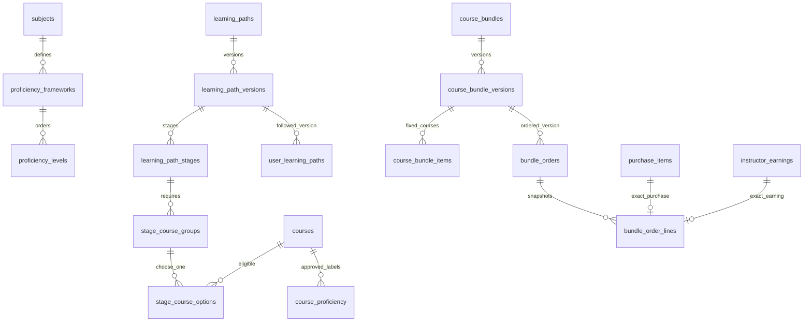

# Lộ trình và combo — triển khai & kiểm chứng

Ngày kiểm chứng: 11/11/2026. Đây là module mở rộng hệ thống hiện có, không thay course ID/slug, lesson, quyền đã mua, tiến độ hoặc người nhận doanh thu cũ.

## Quyết định sản phẩm

- Admin/biên tập học thuật tạo framework trình độ theo môn, duyệt nhãn course với căn cứ nội dung, thiết kế chặng và nhóm khóa lựa chọn. Không nhét A1–C2 vào courses.level hoặc suy CEFR từ lớp học.
- Mỗi nhóm học phần chọn một trong các khóa. Chặng xong khi tất cả nhóm có ít nhất một khóa được sở hữu và hoàn thành bài học thật. Đây là tiến độ nội dung, không phải chứng nhận năng lực.
- Rating/doanh số chưa đối soát không tự đổi thứ tự chặng. AI tự tạo nhãn hoặc xuất bản chưa được bật; manual curation là nguồn quyết định hiện hành.
- Combo là các khóa cụ thể, khác với tập khóa thay thế trong lộ trình. Combo liên kết lộ trình phải phủ ít nhất một lựa chọn mỗi học phần và chỉ gồm khóa trong phiên bản đó.
- Bản đã công khai không sửa tại chỗ. Sửa tạo phiên bản mới; người theo học/mua cũ giữ phiên bản và quyền cũ. Ngừng hiện bằng is_active trên root, không xóa lịch sử.

## Schema

Các revision:

1. `d45e67f89a01`: 14 bảng.
2. `e56f78a90b12`: trigger bảo vệ toàn bộ cấu trúc version đã published.
3. `f67a89b01c23`: lưu trữ chế độ minh họa, bỏ `is_demo`, thêm mã ưu đãi combo. Chi tiết hiện hành: [Quản lý catalog chính thức](official-catalog-workflow.md).

Các bảng: proficiency_frameworks, proficiency_levels, course_proficiency; learning_paths, learning_path_versions, learning_path_stages, stage_course_groups, stage_course_options, user_learning_paths; course_bundles, course_bundle_versions, course_bundle_items, bundle_orders, bundle_order_lines.

FK course RESTRICT giữ các liên kết học tập/tài chính; unique version/order/course và check tiền không âm. Trigger chặn sửa/xóa version published, thay con của version published, chuyển con sang version khác; order/line snapshot không thể UPDATE/DELETE. Các course có thể dùng trong nhiều path/combo.

## Giá và đối soát

Khi publish, phân bổ giá combo theo tỷ trọng giá lẻ VND, làm tròn 0.01 bằng largest remainder, tổng luôn bằng giá combo. Bản published giữ list_price/allocated_price; giá lẻ thay đổi sau đó không viết lại lịch sử. Giá combo không cao hơn tổng giá lẻ.

Quote kiểm tra khóa public/approved/not deleted và provider policy, quyền sở hữu active. Đã sở hữu giảm đúng allocated_price của khóa đó. Áp dụng tối đa một mã riêng của combo lên số còn phải trả; không dùng coupon khóa lẻ. Quote hash gắn user, version, danh sách, người giảng dạy, giá, ownership và thời hạn hoàn tiền; client không gửi amount. Thay đổi quote yêu cầu xem và xác nhận lại.

Checkout:

1. Xác thực user; cấm user khóa/xóa, nội dung đã lưu trữ hoặc mua khóa do chính mình giảng dạy.
2. Advisory transaction lock theo buyer dùng chung với checkout/enroll legacy; course lock theo UUID, ví và treasury lock rõ ràng. Course NO KEY UPDATE để không chặn FK inserts của payout.
3. Idempotency key unique theo buyer. Retry cùng request trả đơn cũ; reuse key cho request khác trả 409.
4. Trừ tổng ví đúng một lần; lưu snapshot order và line. Mỗi line chưa sở hữu có transaction/purchase_item riêng, earning riêng nếu trả tiền và enrollment. Free line chỉ tạo quyền học, không tạo giao dịch giá trị 0; line đã sở hữu không sinh purchase/earning mới.
5. Tất cả commit một transaction; lỗi sau khi bắt đầu ghi rollback cả ví, order, earning, enrollment và treasury hold.

Mỗi line có transaction riêng vì code legacy refund/payout trước đây giả định một earning/purchase trên transaction. Không giả vờ bulk transaction cũ đã có mapping chính xác. Refund legacy nhiều item/earning chưa đối soát trả conflict khi xin/duyệt hoàn, tránh hoàn nhầm; không sửa ngầm dữ liệu lịch sử.

Refund combo dispatch từ endpoint refund hiện tại qua bundle_order_lines. Số hoàn là allocated_price thực trả, gồm cả phần platform, không chỉ phần instructor. Chỉ nhận yêu cầu khi còn thời hạn hold và earning holding. Admin/giảng viên đúng line xử lý; khóa earning ngăn cạnh tranh với release. Hoàn một line không sửa transaction/earning của line khác. Gỡ enrollment nếu không còn nguồn purchase completed khác, giữ lesson progress. Pending/escalated refund giữ payout đến khi xử lý; approval/release không chạy lặp.

Payout scheduler hiện tại nhận diện bundle earning và dùng release mới: earning + instructor wallet + treasury được khóa; tiền instructor cộng đúng share, platform fee nhận diện đúng và holding giảm theo line. Chưa có ví hợp lệ hoặc ví bị khóa thì giữ pending, không chuyển sang paid. Đây là chuyển trong ví nội bộ, không gọi payout ngân hàng/PayPal ra ngoài.

Treasury balance vẫn là custody cash hiện có; combo là chuyển liability trong ví, không tạo thêm topup/tiền mặt. holding_amount theo dõi khoản combo chờ xử lý; platform_fee_total tăng khi release. Không tự đối soát lại số dư/counters legacy.

## Giao diện

- `/lo-trinh`, `/lo-trinh/{slug}`: thư viện, chặng/học phần, khóa thay thế, theo dõi và tiến độ thực.
- `/lo-trinh/cua-toi`: quay lại version đã theo dõi.
- `/combo`, `/combo/{slug}`: khóa cụ thể, giá phân bổ, phần đã sở hữu, thời hạn hoàn, quote → xác nhận → receipt.
- `/combo/don-hang`, `/combo/don-hang/{id}`: đơn theo user và từng line/refund.
- `/admin/learning-paths`: framework, nhãn course, editor stage/group/course, xem/duyệt, phiên bản mới và ẩn/hiện.
- `/admin/bundles`: chọn khóa bằng tìm kiếm, giá, link path, draft/review/publish/clone phiên bản.

Cloudy Blue semantic tokens, shared Button/Input/Badge/Modal. Dialog có focus trap, trả focus, Escape/scroll lock; confirm bị khóa khi request đang chạy. Loading/error/retry/empty states có sẵn. Nút không trừ ví trước bước xác nhận. Chỉ quản lý nội dung chính thức; khóa mẫu cũ bị chặn ngay cả khi lưu bản nháp qua API. Metadata detail đọc public API; không dùng tên giả cho nội dung thật.

## API

Prefix `/api/v1` (web `/api`). Public GET `/learning-paths`, `/learning-paths/frameworks`, `/learning-paths/{slug}`, `/learning-paths/versions/{id}`, `/bundles`, `/bundles/{slug}`, `/bundles/versions/{id}/quote`.

Authenticated: GET `/learning-paths/my`, POST `/learning-paths/versions/{id}/follow`; POST `/bundles/checkout` body `{version_id,quote_hash,idempotency_key,coupon_code?}`; GET `/bundles/orders/my`, `/bundles/orders/{id}`. Receipt chỉ của buyer, ID khác trả 404.

Admin: GET/POST `/admin/learning-paths`, `/admin/bundles`; GET `/{module}/versions/{id}`, POST `/{module}/versions/{id}/publish`, PUT `/{module}/{root_id}/active?active=...` dưới `/admin`. Course picker `/admin/learning-paths/course-options`; GET/PUT `/admin/courses/{id}/proficiency`; POST `/admin/learning-paths/frameworks`.

API admin-only được kiểm tra phía server; Pydantic extra=forbid, limits, UUID, Decimal. 401/403 thiếu quyền, 404 resource không được xem, 409 quote/state/idempotency xung đột, 402 thiếu ví, 422 dữ liệu sai, 503 thiếu cấu hình đối soát. Các API course/enrollment/mobile cũ giữ nguyên; mobile có types/services cho module mới, chưa thêm UI native.

## Triển khai

- Backup mới trước migration. Local đã backup tại `studynest_be/backups/paths-bundles/before-*.dump`, private/ignored.
- Chạy `.venv/bin/python -m alembic upgrade head`. Không sửa db.sql lớn. DB mới đi qua bootstrap hiện có rồi Alembic head/seed taxonomy.
- Tạo nội dung chính thức bằng admin: lưu bản nháp → kiểm tra → xuất bản. Script seed minh họa và ảnh mẫu đã được gỡ.
- Downgrade chỉ DB thử/đã backup: mất metadata path/bundle/order V2; legacy course/payment rows giữ nguyên nhưng không đủ phục hồi liên kết đơn combo nếu không restore snapshot. Production ưu tiên rollback code, giữ additive schema và bảo toàn snapshots.

## Kiểm chứng và giới hạn release

Đã chạy round trip upgrade → downgrade về c34d56e78f90 → upgrade trên DB riêng. Tests PostgreSQL bao gồm phân bổ làm tròn, owned credit, quote stale, wallet thiếu, fault injection rollback, concurrent retry một lần trừ ví, exact refund, payout không lặp, pending refund, version/child/snapshot DB guards, IDOR, authorization, HTTP extra amount rejection và progress chọn một option.

Kết quả kiểm tra hiện hành: [Official catalog review](official-catalog-review.md). Báo cáo bàn giao giai đoạn đầu được giữ làm lịch sử; số liệu và đường dẫn demo trong đó không còn hiện hành.

Trước mở production cần staging E2E với tài khoản buyer/lecturer/admin, đủ ví và quy trình đối soát thực; kiểm tra monitoring/backup/restore và reconciliation lịch sử. Không thực hiện giao dịch thật hoặc deploy production trong phiên này. CORS/SSL convention và warnings legacy ngoài module vẫn cần audit deployment; tests/build không tự chứng minh toàn bộ nền tảng production-ready. Module này chưa triển khai AI tạo path, đánh giá/chứng chỉ năng lực, payee tổ chức, coupon stacking, bundle subscription hoặc auto thêm course mới vào đơn cũ.
